# MindRush — AI Question Generation & Governance Subsystem

This document provides a technical walkthrough of the **AI-Assisted Question Generation and Question Bank Expansion** subsystem (Feature 001).

---

## 1. End-to-End Workflow Pipeline

```mermaid
sequenceDiagram
    autonumber
    actor Admin as Content Administrator
    participant Node as Node.js Backend (server/)
    participant DB as MongoDB
    participant AI as Python AI Service (FastAPI)
    participant Ollama as Local Ollama (qwen3.5:4b)
    participant Game as Educational Mode Game

    Admin->>Node: POST /api/admin/generation (Topic, Standard, Difficulty, Count)
    Node->>DB: Create GenerationBatch (status: 'generating', request_hash, idempotency_key)
    Node->>AI: POST /internal/generation/generate
    AI->>Ollama: Generate JSON (num_ctx: 2048, think: false, num_predict: 1024)
    Ollama-->>AI: Valid JSON Questions Array
    AI-->>Node: Questions Payload + Token Metrics
    Node->>DB: Save GeneratedQuestions (status: 'pending_validation')
    
    rect rgb(20, 30, 45)
        note over Node,AI: Automated Validation Pipeline
        Node->>AI: POST /internal/validation/validate
        AI->>AI: 1. Pydantic MCQ Schema Validation
        AI->>AI: 2. Safe AST Math Evaluation
        AI->>AI: 3. 4-Tier Duplicate Check vs 100 Canonical Questions
        AI-->>Node: Validation Report
        Node->>DB: Save ValidationResult & update status ('pending_review' or 'validation_failed')
    end

    Admin->>Node: GET /api/admin/questions/pending-review
    Admin->>Node: POST /api/admin/questions/:id/review (Decision: 'approved')
    Node->>DB: Update question status & record AuditLog

    Admin->>Node: POST /api/admin/questions/publish
    Node->>DB: Increment Counter ('published_question_id' -> 1001+)
    Node->>Node: Staged write to educational-questions-published.js.tmp -> rename
    Node-->>Admin: Publication Success (Total bank updated)

    Game->>Game: Statically imports published companion file into gameplay
```



---

## 2. Multi-Tier Automated Validation

Before reaching the human review queue, every generated question undergoes 3 validation tiers:

1. **Pydantic Schema Validation:**
   - Enforces exactly 4 options labeled `A`, `B`, `C`, `D`.
   - Rejects empty strings and duplicate option texts.
   - Verifies that `String(correct_answer.value).trim()` strictly matches the text of `correct_option_id`.
2. **Deterministic Safe AST Math Evaluation:**
   - Evaluates arithmetic binary expressions (addition and subtraction) using Python's `ast` module.
   - Operates without `eval()` or code execution vulnerabilities.
   - Verifies claimed answer against calculated ground truth.
3. **4-Tier Duplicate Detection:**
   - **Tier 1:** Exact stem match against canonical questions.
   - **Tier 2:** Case-insensitive and punctuation-stripped normalized stem match.
   - **Tier 3:** Levenshtein string distance ratio (threshold: &ge; 0.85).
   - **Tier 4:** Jaccard token overlap ratio (threshold: &ge; 0.80).

---

## 3. Atomic Publication & Companion File Staging

To guarantee zero race conditions and prevent partial file corruption:

- **Atomic Sequence Generation:** Monotonic IDs starting at `1001` are allocated using MongoDB's `$inc` operator on the `counters` collection (`published_question_id`).
- **Staged File Replacement:** The question publisher writes the updated array to `educational-questions-published.js.tmp` and performs an atomic POSIX filesystem `renameSync` to overwrite `educational-questions-published.js`.
- **Game Engine Hot-Reload:** `public/js/game/educational-questions.js` statically imports `PUBLISHED_QUESTIONS` and exports:
  ```javascript
  export const EDUCATIONAL_QUESTIONS = [...ORIGINAL_QUESTIONS, ...(PUBLISHED_QUESTIONS || [])];
  ```
  This ensures synchronous availability during gameplay without HTTP round-trips.
