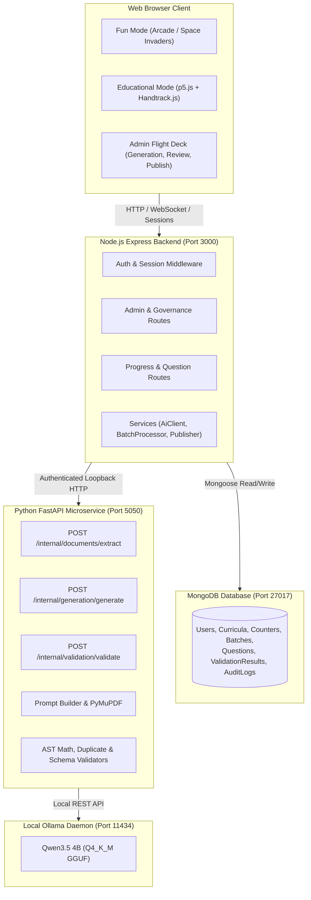

# MindRush — System Architecture

This document describes the high-level and detailed architecture of **MindRush**, covering the dual-mode gaming client, Node.js authoritative backend, MongoDB persistence layer, and the stateless Python AI question generation microservice.

---

## 1. High-Level Architecture Overview

MindRush is structured as a decoupled multi-tier system:

---

## 2. Core Architectural Principles & Invariants

1. **Authoritative Database Writer:**
   - **Node.js is the sole database writer**. All MongoDB connection credentials, Mongoose schemas, indexes, and session persistence remain in the Node.js domain.
   - The **Python FastAPI microservice has ZERO database access** and possesses no database credentials. It operates as a stateless compute engine.
2. **Zero In-Game Inference Latency:**
   - LLM generation occurs **asynchronously out-of-band** via the Content Administrator workflow.
   - During gameplay, questions are served synchronously from statically loaded bundles (`educational-questions.js` + companion `educational-questions-published.js`) or cached delivery endpoints, guaranteeing 60 FPS gameplay.
3. **Strict Human-in-the-Loop Governance:**
   - Generated questions must pass automated multi-tier validation before entering the human review queue.
   - Only human administrators can mark a question `approved`.
   - Publication allocates atomic sequential IDs and updates companion modules using staged temporary file replacement.

---

## 3. Subsystem Breakdown

### A. Frontend Gaming Client
- **Core Technology:** HTML5 Canvas, p5.js, Handtrack.js / MediaPipe for webcam hand gesture detection.
- **Fun Mode:** Breakout and Space Invaders arcade mechanics with power-ups and boss battles.
- **Educational Mode:**
  - `EducationalEngine.js`: Controls falling question/answer objects with paddle interception.
  - Normalizer: Validates and sanitizes option texts, matching indices, and correct answer equality.
  - Question Banks: Original 100 canonical Olympiad questions + dynamically published questions.

### B. Node.js Backend & API Layer (`server/`)
- **Express.js Server (`server.js`, `app.js`):**
  - Session authentication with Argon2id password hashing.
  - Administrative security middleware (`requireAdmin.js`) requiring valid session, `role === 'admin'`, and `X-Requested-With: MindRush-Admin` CSRF header.
- **Service Layer (`server/services/`):**
  - `ai-client.js`: Loopback HTTP client communicating with FastAPI over `http://127.0.0.1:5050`.
  - `batch-processor.js`: Dispatches question validation and updates MongoDB state.
  - `question-publisher.js`: Atomic MongoDB counter increment and staged atomic file writes (`.tmp` &rarr; rename).

### C. Python AI Subsystem (`MindRush-AI/ai_service/`)
- **FastAPI Engine (`app.py`):**
  - Enforces `X-Internal-Secret` header authorization on all internal endpoints.
  - Hardware concurrency mutex locking (limit = 1) ensuring single-threaded GPU load on 4GB VRAM devices.
- **Generator (`generator/`):**
  - `ollama_client.py`: Communicates with Ollama REST API targeting `qwen3.5:4b`. Enforces JSON format, `think: false`, and bounded context (2048).
  - `prompt_builder.py`: Extracts few-shot reference examples from canonical questions and parsed CMO source documents.
- **Validator (`validator/`):**
  - `math_validator.py`: Safe Python AST evaluation of addition and subtraction arithmetic.
  - `duplicate_detector.py`: 4-tier similarity detection (exact, normalized, Levenshtein distance, token Jaccard overlap).
  - `schema_validator.py`: Pydantic model enforcing 4 unique options, distinct texts, and answer consistency.
- **Extractor (`extractor/`):**
  - `pdf_extractor.py`: PyMuPDF extraction with canonical directory path containment (`os.path.realpath` against `DATASET_ROOT`).
