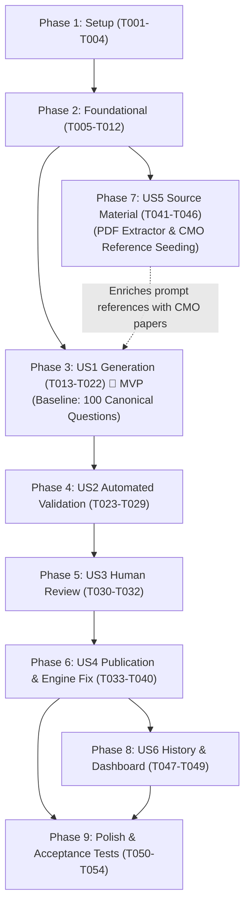

# Tasks: AI-Assisted Question Generation and Question Bank Expansion

**Input**: Design documents from `/specs/001-ai-question-generation/`  
**Prerequisites**: [plan.md](file:///d:/MindRush/specs/001-ai-question-generation/plan.md), [spec.md](file:///d:/MindRush/specs/001-ai-question-generation/spec.md), [research.md](file:///d:/MindRush/specs/001-ai-question-generation/research.md), [data-model.md](file:///d:/MindRush/specs/001-ai-question-generation/data-model.md), [contracts/admin-api.md](file:///d:/MindRush/specs/001-ai-question-generation/contracts/admin-api.md), [quickstart.md](file:///d:/MindRush/specs/001-ai-question-generation/quickstart.md), [v1-phase-map.md](file:///d:/MindRush/specs/001-ai-question-generation/v1-phase-map.md), and `.specify/memory/constitution.md`.

**Organization**: Tasks are grouped by implementation phase and user story to enable independent implementation, testing, and MVP delivery.

## Format: `- [ ] [ID] [P?] [Story?] Description with exact file path`
- **[P]**: Can run in parallel (different files, strictly no dependencies on incomplete tasks)
- **[Story]**: User story identifier (`[US1]` through `[US6]`). Setup, Foundational, and Polish phases omit story tags.

---

## Phase 1: Setup (Shared Infrastructure)

**Purpose**: Python virtual environment initialization, approval-controlled Ollama model verification, starter companion file creation, and living document initialization.

- [x] T001 Initialize Python 3.11+ virtual environment (`.venv`) and define dependencies (`fastapi`, `uvicorn`, `pydantic`, `pymupdf`, `httpx`, `pytest`) in `MindRush-AI/requirements.txt`
- [x] T002 [P] Create approval-controlled Ollama candidate model verification script in `MindRush-AI/scripts/setup_ollama.ps1` that checks daemon status (`127.0.0.1:11434`), inspects installed tags via `ollama list`, reports candidate `qwen3.5:4b` availability, quantization profile, and parameters, documents model license verification as a required human check, strictly does NOT auto-download or pull models without explicit user approval, and notes that 4 GB VRAM suitability must be verified via actual generation test rather than assumed from metadata
- [x] T003 [P] Define application configuration, internal loopback secrets, and canonical dataset root paths in `.env.example` and `MindRush-AI/ai_service/config.py`
- [x] T004 [P] Create initial fallback companion file `public/js/game/educational-questions-published.js` exporting `export const PUBLISHED_QUESTIONS = [];` to guarantee zero 404 module load errors on clean checkout, and initialize living documentation registers in `docs/DEVELOPMENT_LOG.md`, `docs/CHANGELOG.md`, `docs/FILE_CHANGE_REGISTER.md`, `docs/TEST_REPORT.md`, `docs/INSTALLATION_AND_ENVIRONMENT_LOG.md`, `docs/ERROR_AND_FIX_LOG.md`, and `docs/PROJECT_STATUS.md`

---

## Phase 2: Foundational (Blocking Prerequisites)

**Purpose**: Core infrastructure, Mongoose data models, administrative security middleware, CLI provisioning, and seed scripts that MUST be complete before ANY user story can be implemented.

**⚠️ CRITICAL**: No user story work can begin until this phase is complete.

- [x] T005 [P] Update User model in `server/models/User.js` with authorization field `role: { type: String, required: true, enum: ['player', 'admin'], default: 'player' }`
- [x] T006 [P] Create Curriculum model in `server/models/Curriculum.js` with hierarchical syllabus tree (`curriculum_id` unique string, `name`, `board`, `country`, `academic_year` default null, `syllabus_version` default null, `standards`)
- [x] T007 [P] Create Counter model in `server/models/Counter.js` with atomic sequence generator `getNextSequence(name)` using `$inc` on `seq: { type: Number, default: 1000 }`
- [x] T008 [P] Create AuditLog model in `server/models/AuditLog.js` with fields `actor_id` ref User, `action` enum `['DOCUMENT_UPLOAD', 'BATCH_GENERATE', 'QUESTION_EDIT', 'QUESTION_APPROVE', 'QUESTION_REJECT', 'QUESTION_PUBLISH', 'QUESTION_DISABLE']`, `target_collection`, `target_id`, `details`, and `ip_address`
- [x] T009 Implement secure interactive CLI admin provisioning script in `server/scripts/create-admin.js` ensuring public signup strictly assigns `role: 'player'` (depends on T005)
- [x] T010 Implement administrative security middleware in `server/middleware/requireAdmin.js` preserving session auth (`req.session.userId`), validating user `role === 'admin'`, enforcing Origin/CORS validation against untrusted hosts, and requiring CSRF header `X-Requested-With: MindRush-Admin` for state-changing requests (`POST`, `PUT`, `PATCH`, `DELETE`) (depends on T005)
- [x] T011 [P] Setup FastAPI application shell with internal loopback secret authorization middleware (`X-Internal-Secret: <INTERNAL_API_KEY>`) and health check (`GET /health`) in `MindRush-AI/ai_service/app.py`
- [x] T012 Create database seed script in `server/scripts/seed-curriculum.js` initializing Standard 1 Mathematics CMO curriculum record and atomic counter `published_question_id = 1000` (depends on T006, T007)

**Checkpoint**: Core foundation ready. Node.js is established as the sole database writer, admin routes are secured against CSRF and untrusted origins, and FastAPI loopback communication is authenticated.

---

## Phase 3: User Story 1 - Content Administrator Generates Questions from Source Material (Priority: P1) 🎯 MVP

**Goal**: Enable content administrator to request batch generation of new educational questions for Standard 1 Mathematics using local Ollama LLM with candidate Qwen3.5 4B, enforcing hardware limits (4 GB VRAM, concurrency = 1, context limit 2048), baseline prompt references from the 100 verified canonical questions, and batch idempotency.

**Independent Test**: Can be tested by submitting a generation request for 5 Standard 1 Mathematics Addition questions using canonical question references, verifying that Ollama processes the prompt, batch status transitions from `pending` to `generating` to `completed`, generated questions are persisted with valid schema, and actual local load verifies 4 GB VRAM suitability.

### Implementation for User Story 1
- [ ] T013 [P] [US1] Create SourceDocument model in `server/models/SourceDocument.js` (`filename`, `file_path` unique, `file_hash`, `file_format` enum `['pdf']` for Feature 001 with `xlsx`, `xls`, `docx` marked as Phase 3b, `curriculum_id`, `standard` enum `[1, 2, 3]`, `subject`, `license_info`, `processing_status` enum `['pending', 'extracted', 'error']`, `extracted_question_count`) and SourceQuestion model in `server/models/SourceQuestion.js` (`document_id` ref SourceDocument required, `question_text`, `options` array of strings, `correct_answer`, `has_answer_key` boolean default false, `curriculum_id`, `standard`, `subject`, `topic`)
- [ ] T014 [P] [US1] Create GenerationBatch model in `server/models/GenerationBatch.js` with fields `batch_id` unique UUID, `idempotency_key` unique sparse, `request_hash`, `curriculum_id`, `standard`, `subject`, `topic`, `difficulty` enum `['easy', 'medium', 'hard']`, `requested_count` min 1 max 50, `model_name`, `status` enum `['pending', 'generating', 'validating', 'completed', 'failed']`
- [ ] T015 [P] [US1] Create GeneratedQuestion model in `server/models/GeneratedQuestion.js` with extensible `question_type` enum `['multiple_choice', 'true_false', 'fill_in_blank', 'numeric', 'short_answer']` (default `'multiple_choice'`), defining exact MCQ representation where `options` is an array of exactly 4 distinct `{ id: String, text: String }` objects, `correct_option_id` is the string identifier matching one option, and `correct_answer` is `{ value: Mixed, type: 'number' | 'string' | 'boolean' }` whose trimmed string strictly matches the text of `correct_option_id`, while non-MCQ types support optional options arrays and scalar `correct_answer`, plus fields `question_id` unique UUID, `batch_id` ref GenerationBatch, `curriculum_id`, `standard`, `subject`, `topic`, `difficulty`, `explanation`, `status` enum `['pending_validation', 'validation_failed', 'pending_review', 'approved', 'rejected', 'correction_requested', 'published', 'reported', 'disabled', 'archived']`, and `published_id` unique sparse number
- [ ] T016 [P] [US1] Implement Ollama client with candidate model verification (`qwen3.5:4b`), hardware concurrency mutex (limit = 1), 120s timeout, and JSON format enforcement in `MindRush-AI/ai_service/generator/ollama_client.py`
- [ ] T017 [P] [US1] Implement few-shot prompt builder in `MindRush-AI/ai_service/generator/prompt_builder.py` sourcing initial baseline reference questions from the 100 verified canonical questions (`public/js/game/educational-questions.js`), and supporting extracted reference questions from `source_questions` once ingested in US5
- [ ] T018 [US1] Implement internal question generation endpoint `POST /internal/generation/generate` in `MindRush-AI/ai_service/app.py` (depends on T016, T017)
- [ ] T019 [US1] Implement Node.js AI HTTP client service with health check and generation dispatch in `server/services/ai-client.js` (depends on T011, T018)
- [ ] T020 [US1] Implement admin batch generation routes with idempotency validation and single-batch mutex lock (`POST /api/admin/generation`, `GET /api/admin/generation/:batchId`) in `server/routes/admin.js` (depends on T010, T014, T015, T019)
- [ ] T021 [P] [US1] Build admin question generation UI form and batch status monitor in `public/admin/generate.html` and `public/admin/js/generate.js`
- [ ] T022 [US1] Contract and integration tests for generation idempotency, concurrency lock, batch polling, and actual 4 GB VRAM hardware load verification using canonical question references in `tests/test_generation_batch.mjs` and `MindRush-AI/tests/test_ollama_client.py` (depends on T020)

**Checkpoint**: User Story 1 complete and independently testable as MVP using canonical questions as baseline reference. AI generation runs locally without blocking the main event loop.

---

## Phase 4: User Story 2 - Content Administrator Validates Generated Questions (Priority: P1)

**Goal**: Automatically validate every generated question for schema integrity, deterministic arithmetic correctness, duplicate similarity against the existing 100 questions, and option consistency before entering human review.

**Independent Test**: Provide questions with valid math, incorrect math, duplicate stems, and mismatched correct answers; verify deterministic math validator flags incorrect arithmetic, duplicate detector flags similarity, and only valid questions reach `pending_review`.

### Implementation for User Story 2
- [ ] T023 [P] [US2] Create ValidationResult model in `server/models/ValidationResult.js` with fields `question_id` ref GeneratedQuestion unique, `schema_valid` boolean, `answer_valid` boolean, `recalculated_value` Mixed, `duplicate_check` enum `['passed', 'flagged_near', 'flagged_exact']`, `similarity_score` number, `most_similar_id` number, `curriculum_check` enum `['passed', 'review_required', 'failed']`, `difficulty_check` enum `['passed', 'review_required']`, `language_check` enum `['passed', 'flagged']`, `option_check` enum `['passed', 'failed']`, `overall_status` enum `['pending_review', 'validation_failed']`, and `errors` array of strings
- [ ] T024 [P] [US2] Implement deterministic arithmetic validator using safe AST evaluation for addition and subtraction in `MindRush-AI/ai_service/validator/math_validator.py`
- [ ] T025 [P] [US2] Implement 4-tier duplicate detector (exact match, normalized stem, Levenshtein distance, token overlap) against the 100 questions in `public/js/game/educational-questions.js` in `MindRush-AI/ai_service/validator/duplicate_detector.py`
- [ ] T026 [P] [US2] Implement Pydantic schema validator in `MindRush-AI/ai_service/validator/schema_validator.py` verifying that for MCQ questions: `options` has exactly 4 items with unique `id`s and distinct non-empty `text`, `correct_option_id` exists and matches one option `id`, `String(correct_answer.value).trim()` strictly equals that option's `text`, and no other option has identical text
- [ ] T027 [US2] Implement internal validation endpoint `POST /internal/validation/validate` orchestrating math, duplicate, and schema checks in `MindRush-AI/ai_service/app.py` (depends on T024, T025, T026)
- [ ] T028 [US2] Integrate automated validation pipeline and batch question status transitions into `server/services/batch-processor.js` (depends on T023, T027)
- [ ] T029 [US2] Unit and integration tests for deterministic arithmetic recalculation and duplicate detection in `MindRush-AI/tests/test_math_validator.py` and `tests/test_validation_pipeline.mjs` (depends on T028)

**Checkpoint**: User Story 2 complete. Flawed or duplicate questions are automatically intercepted with actionable error reasons.

---

## Phase 5: User Story 3 - Content Reviewer Approves or Rejects Generated Questions (Priority: P2)

**Goal**: Enable authorized reviewers to inspect validated questions in `pending_review`, approve them for publication, reject them with a mandatory reason, or edit question text/options.

**Independent Test**: Reviewer logs into admin interface, views pending questions with validation reports, approves Question A (status becomes `approved`), and rejects Question B with reason (status becomes `rejected` with reason recorded in MongoDB).

### Implementation for User Story 3
- [ ] T030 [US3] Implement review endpoints in `server/routes/admin.js` (`GET /api/admin/questions/pending-review`, `POST /api/admin/questions/:id/review` accepting `decision: 'approved' | 'rejected' | 'correction_requested'` and mandatory `reason` on rejection, `PATCH /api/admin/questions/:id`) (depends on T010, T015, T023)
- [ ] T031 [P] [US3] Build human review queue interface displaying question stem, 4 options, recalculated math value, and duplicate similarity scores in `public/admin/review.html` and `public/admin/js/review.js`
- [ ] T032 [US3] Unit and contract tests for human review state transitions, rejection reasons, and audit log recording in `tests/test_review_workflow.mjs` (depends on T030)

**Checkpoint**: User Story 3 complete. Strict human-in-the-loop governance guarantees zero automated publications.

---

## Phase 6: User Story 4 - Content Administrator Publishes Approved Questions to the Production Question Bank (Priority: P2)

**Goal**: Publish approved questions into `educational-questions-published.js` with non-colliding IDs (1001+) using staged `.tmp` -> `rename` file writing and atomic MongoDB counter, while repairing `EducationalEngine` with a tightened, backward-compatible constructor normalizer.

**Independent Test**: Publish approved questions; verify companion file generated with IDs >= 1001; verify original 100 questions remain intact; verify all 8 explicit `EducationalEngine` acceptance test cases pass.

### Implementation for User Story 4
- [ ] T033 [P] [US4] Implement canonical question adapter in `server/services/question-adapter.js` strictly filtering only approved questions where `question_type === 'multiple_choice'` with 4 options, mapping option `{ id, text }` objects to `options: [optA.text, optB.text, optC.text, optD.text]` and `correct_answer.value` to `correctAnswer: String(q.correct_answer.value).trim()`, producing canonical `{ id, question, options: [4 strings], correctAnswer, topic }` (leaving non-MCQ questions unpublished in MongoDB)
- [ ] T034 [US4] Implement publication service in `server/services/question-publisher.js` utilizing `Counter.getNextSequence('published_question_id')`, publication mutex, and staged temporary file replacement (`educational-questions-published.js.tmp` -> `educational-questions-published.js`) (depends on T007, T033)
- [ ] T035 [US4] Implement publication endpoint `POST /api/admin/questions/publish` and disable endpoint `POST /api/admin/questions/:id/disable` in `server/routes/admin.js` ensuring disabled questions are omitted from future publications (depends on T010, T034)
- [ ] T036 [P] [US4] Implement tightened backward-compatible constructor normalizer fix in `public/js/game/educational-engine.js`: map questions in constructor; assert `q.options` is array of length >= 2; before string conversion, explicitly reject `undefined`, `null`, empty string `""`, or whitespace-only `q.correctAnswer` with descriptive error (`INVALID_CORRECT_ANSWER`); set `targetAnswer = String(q.correctAnswer).trim()`; find all indices where `String(opt).trim() === targetAnswer`; reject if `matchingIndices.length === 0` (not found) or `matchingIndices.length > 1` (duplicate match); never silently default to index 0; if `q.correctIndex !== undefined`, assert `Number.isInteger(q.correctIndex)`, assert `q.correctIndex >= 0 && q.correctIndex < q.options.length`, and assert `q.correctIndex === resolvedIndex` (reject on conflict); populate `questionText = q.questionText || q.question || ''`
- [ ] T037 [P] [US4] Integrate companion question bank in `public/js/game/educational-questions.js` with static ES module import `import { PUBLISHED_QUESTIONS } from './educational-questions-published.js';` exporting `EDUCATIONAL_QUESTIONS = [...ORIGINAL_QUESTIONS, ...(PUBLISHED_QUESTIONS || [])];` ensuring synchronous question availability before gameplay consumption and backwards compatibility when companion file is empty
- [ ] T038 [P] [US4] Implement backend gameplay delivery endpoints as prepared capabilities in `server/routes/questions.js` (`GET /api/questions/random` and `POST /api/questions/:id/report`) and create QuestionReport model in `server/models/QuestionReport.js`
- [ ] T039 [P] [US4] Build publication manager and approved bank search interfaces in `public/admin/publish.html`, `public/admin/bank.html`, and `public/admin/js/publish.js`
- [ ] T040 [US4] Dual-engine regression test suite and publication atomicity tests in `tests/test_educational_engine_adapter.mjs` (covering all 8 explicit test cases: all 100 originals, all 4 positions, missing answer, no match, invalid index, conflicting index, duplicate options, option shuffle), `tests/test_question_bank_loading.mjs` (verifying synchronous loading, empty companion file handling, and published questions integration), and `tests/test_publication_atomicity.mjs` (depends on T034, T035, T036, T037)

**Checkpoint**: User Story 4 complete. Questions safely expand Educational Mode without breaking arcade gameplay or corrupting answer evaluation.

---

## Phase 7: User Story 5 - Content Administrator Manages Source Material (Priority: P3)

**Goal**: Ingest and manage educational source documents (CMO PDFs) with strict canonical path containment to prevent path traversal attacks, and populate reference questions from the 4 CMO papers.

**Independent Test**: Ingest the 4 CMO papers in `MindRush-AI/dataset/standard 1/mathematics/`; verify extracted text and questions; verify path traversal attempts (`..`, null bytes, symlinks) and unsupported formats return 400 Bad Request; verify generation can now use CMO extracted references.

### Implementation for User Story 5
- [ ] T041 [US5] Seed initial reference questions by parsing the 4 CMO PDF papers in `MindRush-AI/dataset/standard 1/mathematics/` into `source_documents` and `source_questions` via `server/scripts/seed-source-documents.js` (depends on T013, T042, T043, utilizing the extraction service)
- [ ] T042 [P] [US5] Implement PyMuPDF PDF extractor with strict canonical path containment (`os.path.realpath` against `DATASET_ROOT`) in `MindRush-AI/ai_service/extractor/pdf_extractor.py`, strictly restricted to `.pdf` format (marking XLSX/XLS/DOCX as Phase 3b) and rejecting path traversal or unsupported formats with `400 Bad Request`
- [ ] T043 [US5] Implement internal document extraction route `POST /internal/documents/extract` in `MindRush-AI/ai_service/app.py` (depends on T042)
- [ ] T044 [US5] Implement document upload and catalog routes in `server/routes/admin.js` (`POST /api/admin/documents`, `GET /api/admin/documents`) enforcing PDF-only uploads and rejecting non-PDF files with `400 Bad Request` (depends on T010, T013, T043)
- [ ] T045 [P] [US5] Build source document manager UI in `public/admin/documents.html` and `public/admin/js/documents.js`
- [ ] T046 [US5] Unit and security tests for PDF extraction, path traversal prevention, and generation using CMO references in `MindRush-AI/tests/test_pdf_extractor.py` and `MindRush-AI/tests/test_path_security.py` (depends on T041, T043)

**Checkpoint**: User Story 5 complete. Provenance is tracked, source materials are securely ingested, and CMO extracted questions are available as generation references alongside canonical questions.

---

## Phase 8: User Story 6 - Content Administrator Reviews Generation and Approval History (Priority: P3)

**Goal**: Provide content administrators with operational visibility across generation batches, validation statistics, publication metrics, and immutable audit logs.

**Independent Test**: Load the admin dashboard; verify statistics match MongoDB counts across documents, batches, review queues, published questions, and audit logs.

### Implementation for User Story 6
- [ ] T047 [US6] Implement dashboard statistics and audit log routes in `server/routes/admin.js` (`GET /api/admin/dashboard`, `GET /api/admin/audit-logs`, `GET /api/admin/batches`) (depends on T010, T014, T015, T023)
- [ ] T048 [P] [US6] Build dashboard analytics overview in `public/admin/index.html` and `public/admin/js/dashboard.js`
- [ ] T049 [US6] Contract and integration tests for dashboard metrics aggregation and audit log filtering in `tests/test_dashboard_audit.mjs` (depends on T047)

**Checkpoint**: All user stories complete. Full operational visibility and governance auditing active.

---

## Phase 9: Polish & Cross-Cutting Concerns

**Purpose**: Execute end-to-end acceptance test suite from `quickstart.md`, verify zero regressions on original gameplay, and synchronize mandatory continuous reporting logs.

- [ ] T050 [P] Finalize environment specification in `docs/INSTALLATION_AND_ENVIRONMENT_LOG.md`
- [ ] T051 [P] Complete error and fix register in `docs/ERROR_AND_FIX_LOG.md`
- [ ] T052 [P] Update task audit log in `docs/DEVELOPMENT_LOG.md` and file audit register in `docs/FILE_CHANGE_REGISTER.md`
- [ ] T053 Execute full validation scenarios from `quickstart.md` (Acceptance Tests 1 through 9) and record execution results in `docs/TEST_REPORT.md` (depends on T022, T029, T032, T040, T046, T049)
- [ ] T054 Author Phase Completion Reports for Feature 001 in `docs/PHASE_COMPLETION_REPORTS/` and update real-time status in `docs/PROJECT_STATUS.md` (depends on T053)

---

## Dependencies & Execution Order

### Phase Dependencies
1. **Phase 1 (Setup)**: Can start immediately.
2. **Phase 2 (Foundational)**: Depends on Phase 1 completion. **BLOCKS ALL USER STORIES**.
3. **Phase 3 (User Story 1 - P1 🎯 MVP)**: Depends on Phase 2. Enables question generation using the 100 canonical questions as baseline references.
4. **Phase 4 (User Story 2 - P1)**: Depends on Phase 3 generation outputs. Validates questions.
5. **Phase 5 (User Story 3 - P2)**: Depends on Phase 4 validation results. Enables human review.
6. **Phase 6 (User Story 4 - P2)**: Depends on Phase 5 approved questions. Enables publication, companion loading, and engine normalizer fix.
7. **Phase 7 (User Story 5 - P3)**: Depends on Phase 2 models. Implements PDF extraction (T042, T043) and seeds CMO reference questions (T041). Once complete, prompts can reference both canonical and CMO questions.
8. **Phase 8 (User Story 6 - P3)**: Depends on Phases 3–6 to aggregate full operational metrics.
9. **Phase 9 (Polish)**: Depends on all user story phases being completed.

### User Story Dependency Flow



---

## Parallel Execution Opportunities

### Phase 1: Setup
```bash
# Parallel setup tasks:
T002: Ollama candidate model verification (MindRush-AI/scripts/setup_ollama.ps1)
T003: Environment configuration (.env.example & config.py)
T004: Fallback companion file & living documentation (public/.../educational-questions-published.js & docs/*.md)
```

### Phase 2: Foundational
```bash
# Parallel Mongoose models & FastAPI shell:
T005: User model update (server/models/User.js)
T006: Curriculum model (server/models/Curriculum.js)
T007: Counter model (server/models/Counter.js)
T008: AuditLog model (server/models/AuditLog.js)
T011: FastAPI app shell (MindRush-AI/ai_service/app.py)
```

### Phase 3: User Story 1 (Generation)
```bash
# Parallel data models and generation components:
T013: SourceDocument & SourceQuestion models (server/models/SourceDocument.js & SourceQuestion.js)
T014: GenerationBatch model (server/models/GenerationBatch.js)
T015: GeneratedQuestion model (server/models/GeneratedQuestion.js)
T016: Ollama client (MindRush-AI/ai_service/generator/ollama_client.py)
T017: Few-shot prompt builder (MindRush-AI/ai_service/generator/prompt_builder.py)
T021: Admin generation UI (public/admin/generate.html)
```

### Phase 4: User Story 2 (Validation)
```bash
# Parallel validator modules:
T023: ValidationResult model (server/models/ValidationResult.js)
T024: Deterministic math validator (MindRush-AI/ai_service/validator/math_validator.py)
T025: Duplicate detector (MindRush-AI/ai_service/validator/duplicate_detector.py)
T026: Schema & option validator (MindRush-AI/ai_service/validator/schema_validator.py)
```

### Phase 6: User Story 4 (Publication & Engine Fix)
```bash
# Parallel publication and client-side engine components:
T033: Question adapter (server/services/question-adapter.js)
T036: EducationalEngine normalizer fix (public/js/game/educational-engine.js)
T037: Companion question bank loading (public/js/game/educational-questions.js)
T038: Backend game delivery routes (server/routes/questions.js)
T039: Publication manager UI (public/admin/publish.html)
```

---

## Implementation Strategy

### MVP First (Phases 1, 2, and 3 - User Story 1)
1. Complete **Phase 1: Setup** (Python venv, approval-controlled Ollama model check, fallback companion file, docs).
2. Complete **Phase 2: Foundational** (Mongoose models, admin CLI, auth & CSRF middleware).
3. Complete **Phase 3: User Story 1** (Source models, Ollama generation pipeline using the 100 canonical questions as baseline reference, batch endpoints, UI).
4. **STOP and VALIDATE**: Verify generation works end-to-end and outputs structured questions under actual local GPU load.

### Incremental Delivery (Phases 4 through 8)
1. Add **User Story 2 (Validation)**: Automated arithmetic recalculation and duplicate checking prevent invalid questions from progressing.
2. Add **User Story 3 (Review)**: Human review queue enforces mandatory oversight.
3. Add **User Story 4 (Publication & Engine Fix)**: Controlled publication generates companion file, and tightened `EducationalEngine` normalizer repairs answer evaluation without breaking arcade gameplay.
4. Add **User Story 5 (Source Management)**: Secure PDF ingestion extracts the 4 CMO papers and seeds `source_questions`, enriching subsequent generation prompts.
5. Add **User Story 6 (Audit & History)**: Dashboard tracks operational trends and maintains full audit history.
6. Execute **Phase 9 (Polish)**: Run all 9 acceptance test scenarios from `quickstart.md`.
